# PrevQuedasRV — tutorial de uso

O PrevQuedasRV é uma experiência de **realidade virtual para prevenção de quedas em casa**.
A pessoa coloca o celular num óculos Cardboard, ou só segura o celular, e "entra" num cômodo.
Lá ela olha em volta, encontra os riscos de queda e ouve as orientações.

Este tutorial tem duas partes:

1. **[Usando o app](#parte-1--usando-o-app)**: para quem vai fazer a experiência, como pacientes, familiares e alunos.
2. **[Criando ambientes no editor](#parte-2--criando-ambientes-no-editor)**: para profissionais que querem montar
   cômodos novos, marcar riscos, gravar áudios ou usar fotos 360° da casa real de alguém.

---

## Antes de começar

O app e o editor rodam no computador onde o projeto está instalado. Peça para a pessoa responsável
pela parte técnica deixar o programa ligado (comando `npm start`). Depois, abra no navegador
(de preferência o Google Chrome):

| O que | Endereço |
|---|---|
| App | http://localhost:8080 |
| Editor | http://localhost:8080/editor.html |

Para usar o app no **celular**, a pessoa responsável conecta o celular ao computador pelo cabo USB
(comando `npm run phone`). Depois, basta abrir **http://localhost:8080** no Chrome do celular.

---

# Parte 1 — Usando o app

## 1. Tela de entrada

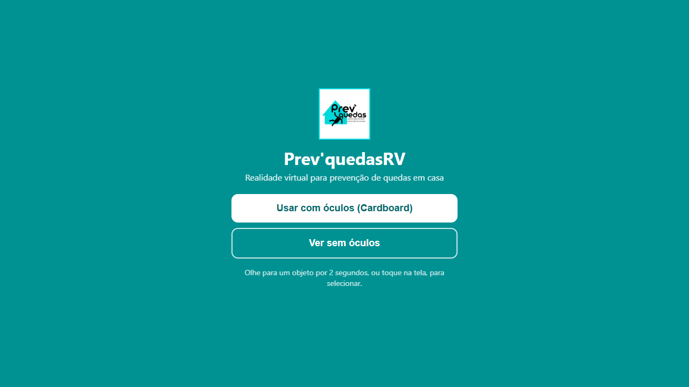

Escolha como usar:

- **Usar com óculos (Cardboard)**: a tela se divide em duas imagens, uma para cada olho. Coloque o celular
  deitado (na horizontal) dentro do óculos.
- **Ver sem óculos**: o celular funciona como uma "janela". Mova o celular para olhar em volta.
  No computador, arraste com o mouse.

## 2. Vídeo de apresentação

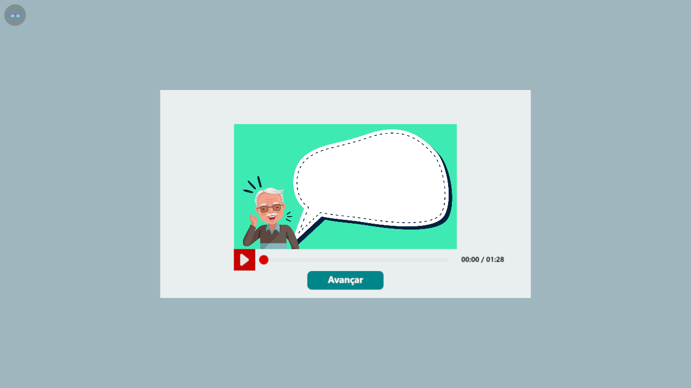

O primeiro passo é um vídeo explicando a experiência. Olhe para o botão ▶ para tocar ou pausar.
Para seguir, olhe para o botão verde **Avançar**, que fica abaixo do vídeo.

## 3. Como selecionar as coisas: a mira

No centro da tela existe uma **mira** (um pequeno círculo branco). Para selecionar algo:

1. Vire a cabeça (ou o celular) até a mira ficar sobre o objeto.
2. Mantenha a mira parada. Um **anel azul** vai se completando em volta dela.
3. Em cerca de **2 segundos** o anel fecha e o objeto é selecionado.

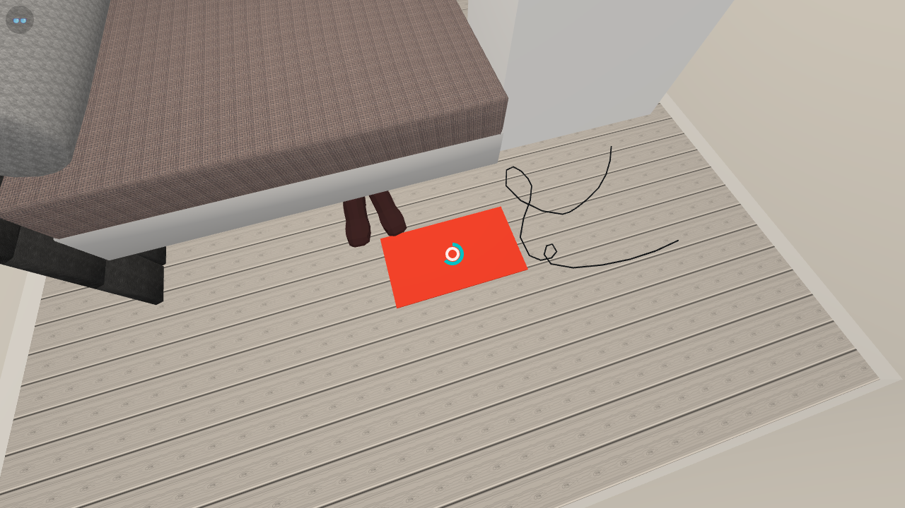

Quando a mira passa sobre um objeto importante, ele **muda de cor**:
**vermelho** indica um risco de queda, e **verde** indica uma adaptação que previne quedas.

Sem óculos, também dá para **tocar na tela** (ou clicar, no computador) em vez de esperar o anel.

## 4. Menu: escolhendo um cômodo

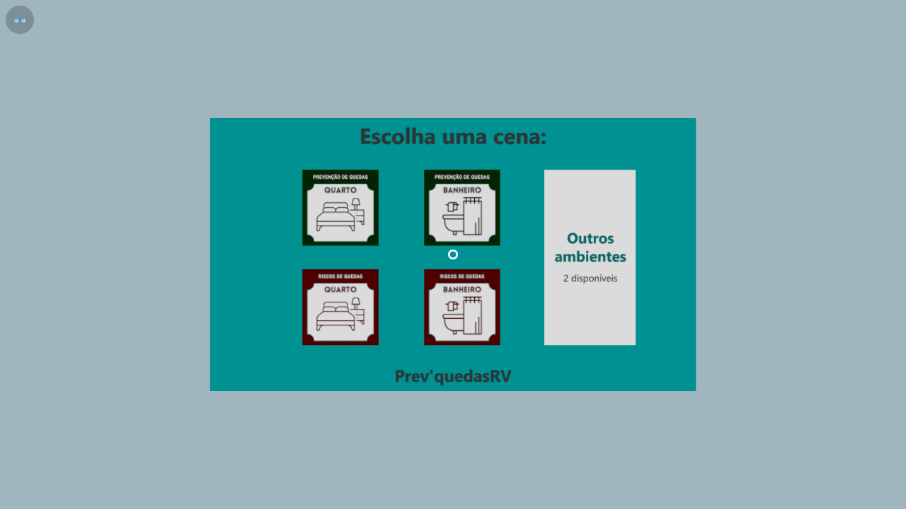

| Opção | O que mostra |
|---|---|
| **Prevenção de quedas — Quarto / Banheiro** | Cômodos já adaptados, mostrando o que é seguro |
| **Riscos de quedas — Quarto / Banheiro** | Os mesmos cômodos, com os perigos espalhados |
| **Outros ambientes** | Aparece quando alguém criou ambientes novos no editor |

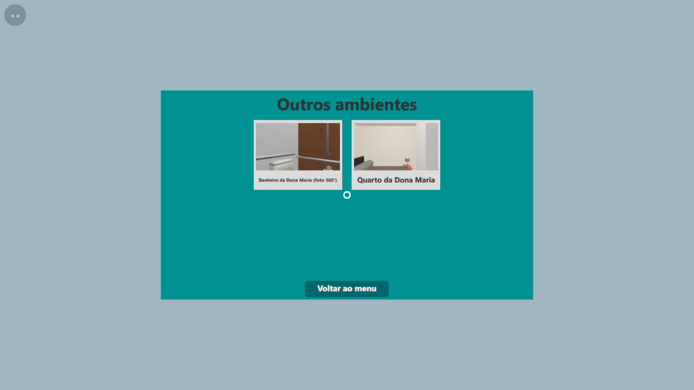

## 5. Dentro de um cômodo

Ao entrar, pode aparecer uma mensagem de boas-vindas (e um áudio) explicando o que fazer:

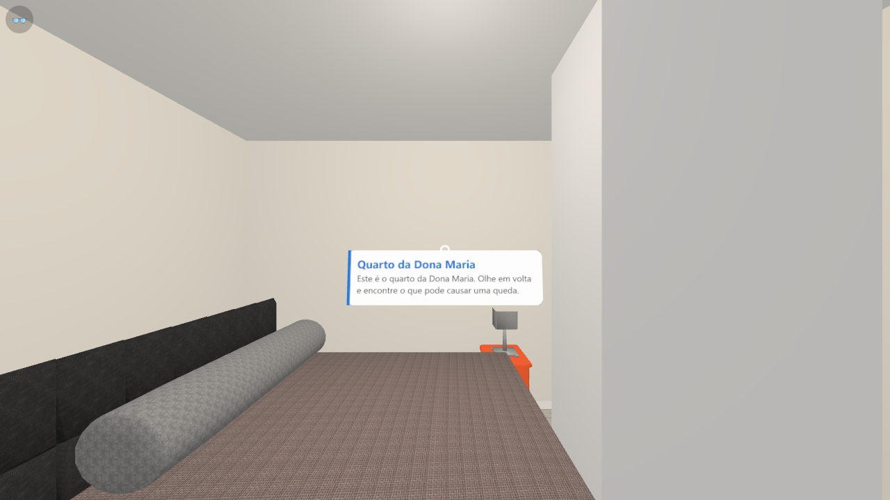

Olhe em volta e selecione os objetos que mudam de cor. Cada um mostra uma **placa** com a explicação
e toca uma **narração**:

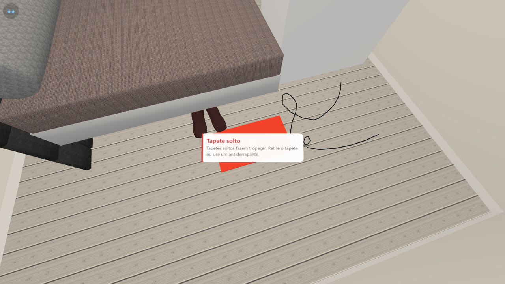

A placa some sozinha quando você olha para outro lado.

## 6. Como voltar ao menu

Há duas formas:

- **Olhe para os seus pés.** Aparece um botão **⌂ Menu**. Mantenha a mira nele.
- Nos cômodos originais, procure o **ícone de casinha** no cenário (no banheiro, fica em cima do vaso).

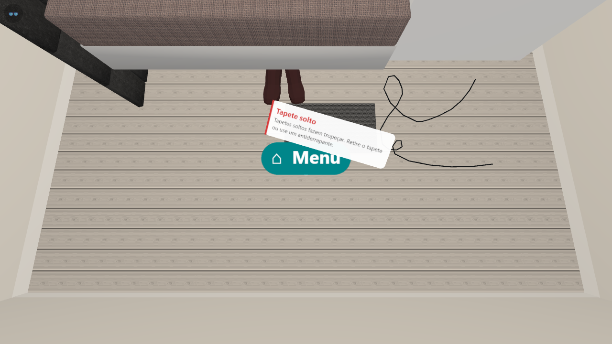

## 7. Com o óculos Cardboard

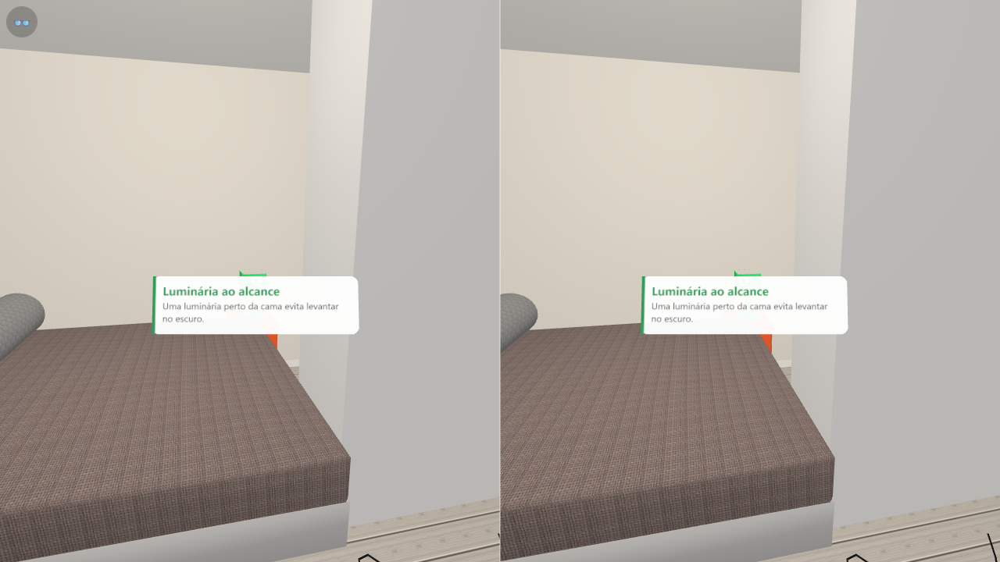

- O botão 👓 no canto da tela liga e desliga o modo óculos a qualquer momento.
- A linha no meio da tela ajuda a encaixar o celular centralizado no óculos.
- Tudo funciona do mesmo jeito: a mira fica no centro de cada olho.

## 8. Ambientes de foto 360°

Alguns ambientes são **fotos panorâmicas** de uma casa de verdade. Os pontos de atenção aparecem como
sinais redondos: **!** vermelho é risco, **✓** verde é prevenção e **i** azul é informação.
Selecione o sinal para ver a explicação.

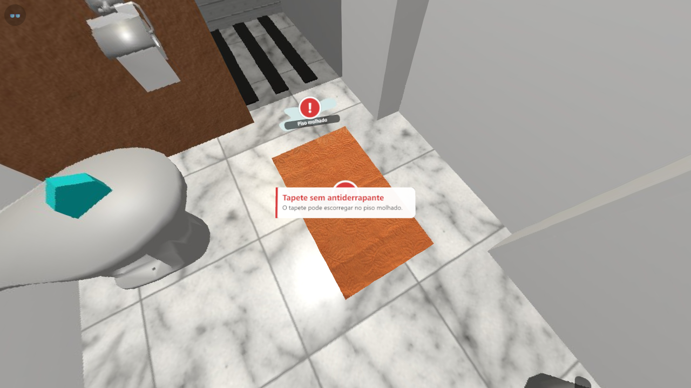

---

# Parte 2 — Criando ambientes no editor

O editor é usado **no computador**, com mouse e teclado. Abra **http://localhost:8080/editor.html**.

> **Tudo é salvo sozinho.** No topo aparece "Salvando…" e depois "Salvo". Não existe botão de salvar.
> Errou? Use **Ctrl+Z** para desfazer (ou o botão ↶ no topo).

## 1. Tela inicial do editor

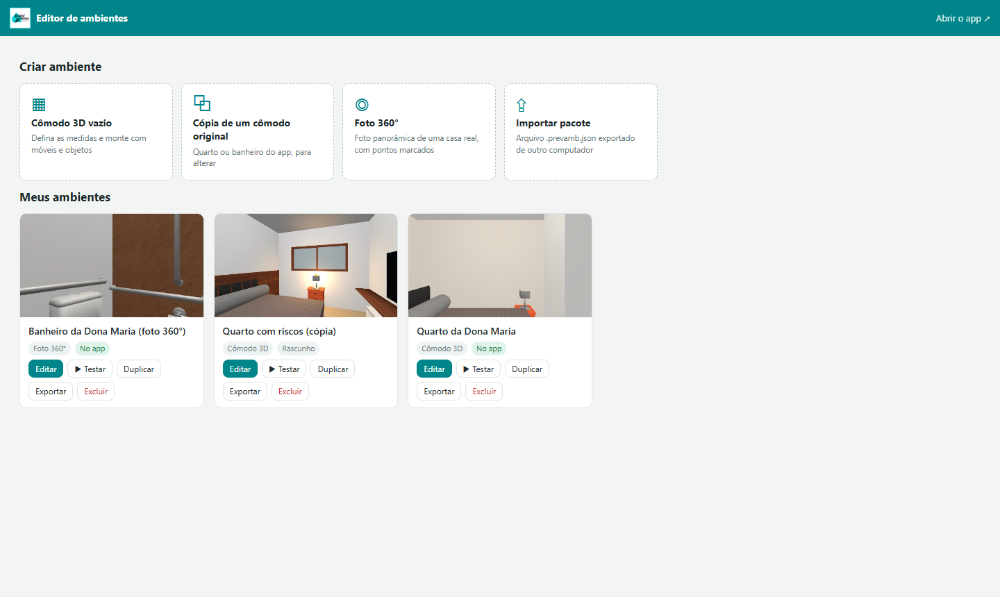

Na parte de cima você cria um ambiente novo. Embaixo ficam os seus ambientes, com as ações:

| Botão | O que faz |
|---|---|
| **Editar** | Abre o ambiente para alterar |
| **▶ Testar** | Abre o ambiente no app, numa nova aba, para ver como o visitante vai ver |
| **Duplicar** | Cria uma cópia, por exemplo para fazer uma versão "com riscos" e outra "adaptada" |
| **Exportar** | Baixa um arquivo com o ambiente completo, para levar a outro computador |
| **Excluir** | Apaga o ambiente e os áudios e fotos dele (pede confirmação) |

As etiquetas mostram o tipo (**Cômodo 3D** ou **Foto 360°**) e se ele está **No app** (publicado)
ou é um **Rascunho**.

Há três tipos de ambiente:

| Tipo | Quando usar |
|---|---|
| **Cômodo 3D vazio** | Montar um cômodo do zero, com móveis |
| **Cópia de um cômodo original** | Partir do quarto ou banheiro que já existem no app e mudar o que quiser |
| **Foto 360°** | Usar uma foto panorâmica da casa real de um paciente |

---

## 2. Criando um cômodo 3D

### 2.1 Medidas

Clique em **Cômodo 3D vazio**, dê um nome e informe as medidas em metros:

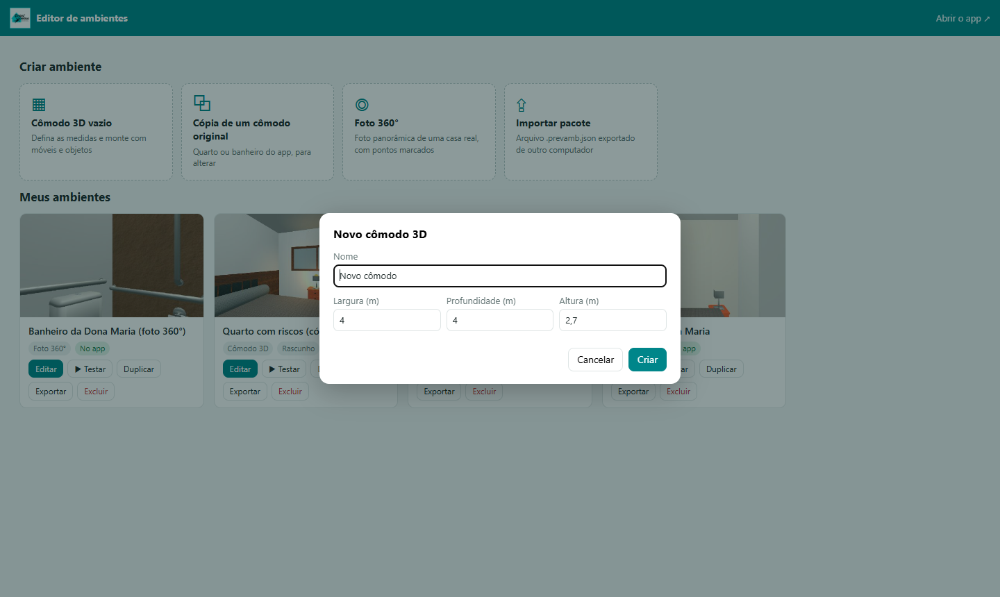

### 2.2 Conhecendo a tela do editor

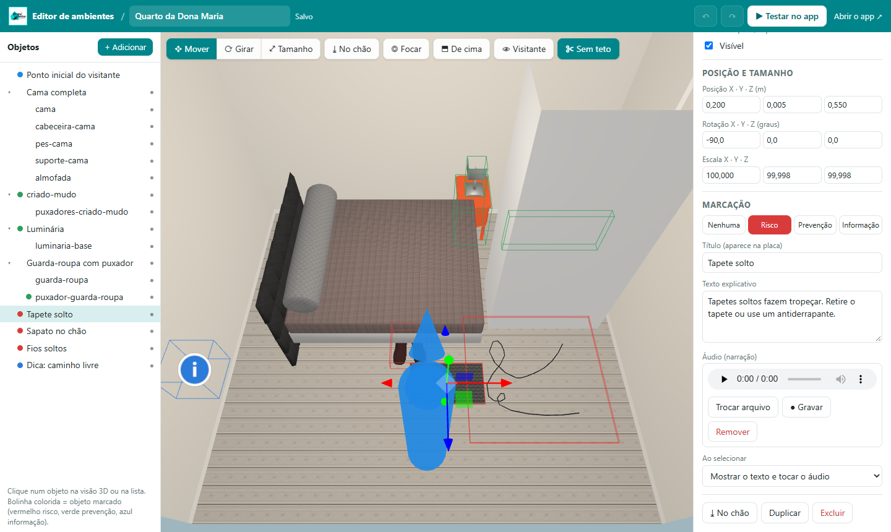

| Área | O que tem |
|---|---|
| **Esquerda: Objetos** | Lista de tudo que está no cômodo. A bolinha colorida mostra objetos marcados (vermelho = risco, verde = prevenção, azul = informação). O ● à direita esconde ou mostra o objeto. |
| **Centro: visão 3D** | O cômodo visto de cima, como uma maquete. **Arraste** para girar a vista, use a **roda do mouse** para aproximar e o **botão direito** para deslocar. |
| **Direita: propriedades** | Detalhes do que estiver selecionado. Sem nada selecionado, mostra as configurações do ambiente. |
| **Topo** | Nome do ambiente (clique para mudar), desfazer/refazer e **▶ Testar no app** |

### 2.3 Adicionando móveis e objetos

Clique em **+ Adicionar**. O objeto aparece no **centro da vista** e é apoiado no chão automaticamente.

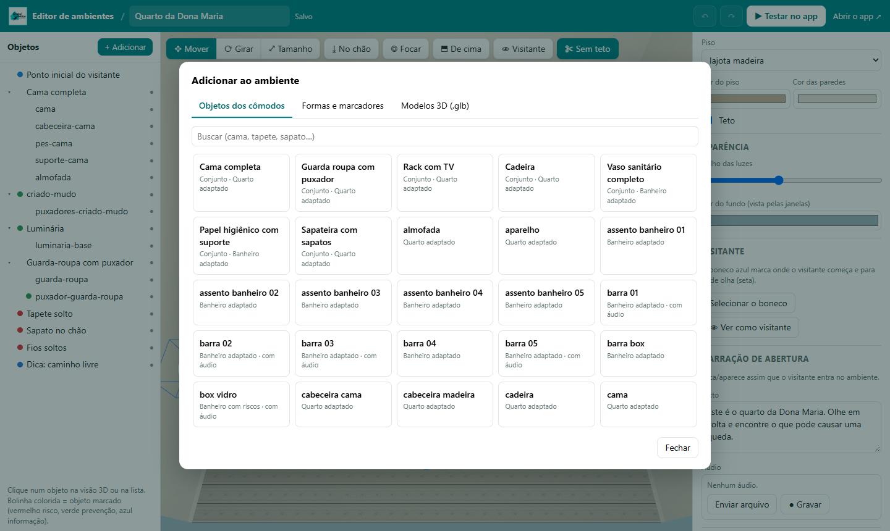

A janela tem três abas:

- **Objetos dos cômodos**: móveis dos cômodos originais. Os primeiros são **conjuntos prontos**
  (cama completa, guarda-roupa, rack com TV, vaso sanitário…). Use a busca para achar algo, como "tapete"
  ou "sapato". Itens "com áudio" já vêm com a narração original.
- **Formas e marcadores**: caixa, tapete/placa, cilindro e esfera, para representar coisas simples
  (um degrau, uma banqueta, um objeto no chão). Aqui também ficam os **marcadores flutuantes** (! ✓ i),
  uma **luz** extra e o **ícone de voltar ao menu**.
- **Modelos 3D (.glb)**: envie um modelo 3D baixado da internet (sites como Poly Haven, Kenney ou Sketchfab;
  confira a licença).

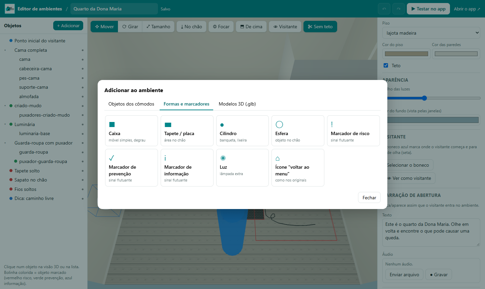

### 2.4 Movendo, girando e mudando o tamanho

Clique num objeto na visão 3D (ou na lista). Aparecem **setas coloridas** sobre ele:

- **✥ Mover** (tecla **W**): arraste uma seta para mover naquela direção.
- **⟳ Girar** (tecla **E**): arraste um dos anéis.
- **⤢ Tamanho** (tecla **R**): arraste os cubinhos.
- **⤓ No chão**: apoia o objeto no piso, ou na mesa que estiver embaixo dele.

Também dá para digitar os valores exatos em **Posição e tamanho**, no painel da direita.

> **Conjuntos:** o primeiro clique numa cama completa seleciona a **cama inteira**. Clique de novo para
> selecionar só uma peça (por exemplo, o travesseiro).

Outros botões úteis: **◎ Focar** (aproxima no objeto selecionado), **⬒ De cima** (vista de cima)
e **✂ Sem teto** (corta o teto para enxergar dentro dos cômodos copiados dos originais).

Teclas: **Delete** apaga, **Ctrl+D** duplica e **Esc** solta a seleção.

### 2.5 Marcando um objeto como risco ou prevenção

Esta é a parte mais importante. Selecione o objeto e, no painel da direita, vá até **Marcação**:

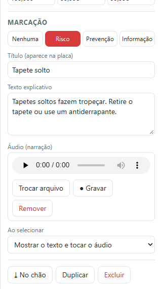

1. Escolha o tipo: **Risco**, **Prevenção** ou **Informação**. O objeto ganha um contorno da mesma cor
   na visão 3D.
2. **Título**: aparece em destaque na placa (ex.: "Tapete solto").
3. **Texto explicativo**: a orientação que a pessoa vai ler.
4. **Áudio (narração)**: duas opções:
   - **Enviar arquivo**: um áudio já gravado (mp3, m4a, wav…);
   - **● Gravar**: grava na hora pelo microfone do computador. Clique de novo em **■ Parar** quando terminar.
     O navegador vai pedir permissão para usar o microfone.
5. **Ao selecionar**: o que acontece quando o visitante escolhe o objeto:
   - **Mostrar o texto e tocar o áudio** (o normal);
   - **Voltar ao menu**;
   - **Ir para: (outro ambiente)**: útil para ligar cômodos. Por exemplo, a porta do quarto leva ao banheiro.

Para tirar a marcação, escolha **Nenhuma**.

### 2.6 Onde o visitante começa

O **boneco azul** mostra onde a pessoa vai estar ao entrar, e a ponta mostra para onde ela olha.
Clique nele para mover (setas) ou girar (**⟳ Girar**).

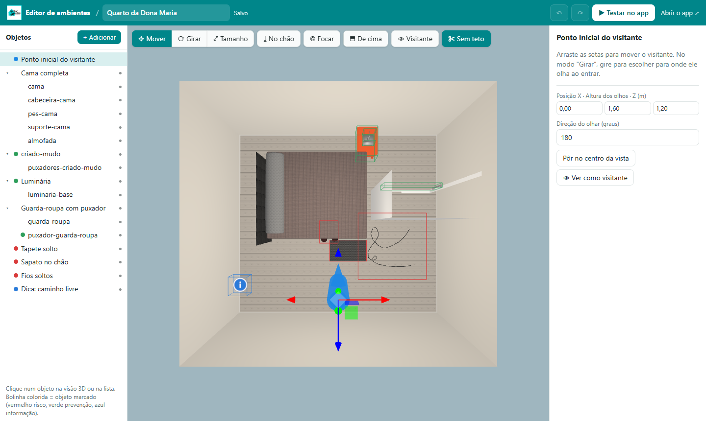

Para conferir, clique em **👁 Visitante**: a visão passa a ser pelos olhos da pessoa.
Arraste para olhar em volta e aperte **Esc** para sair.

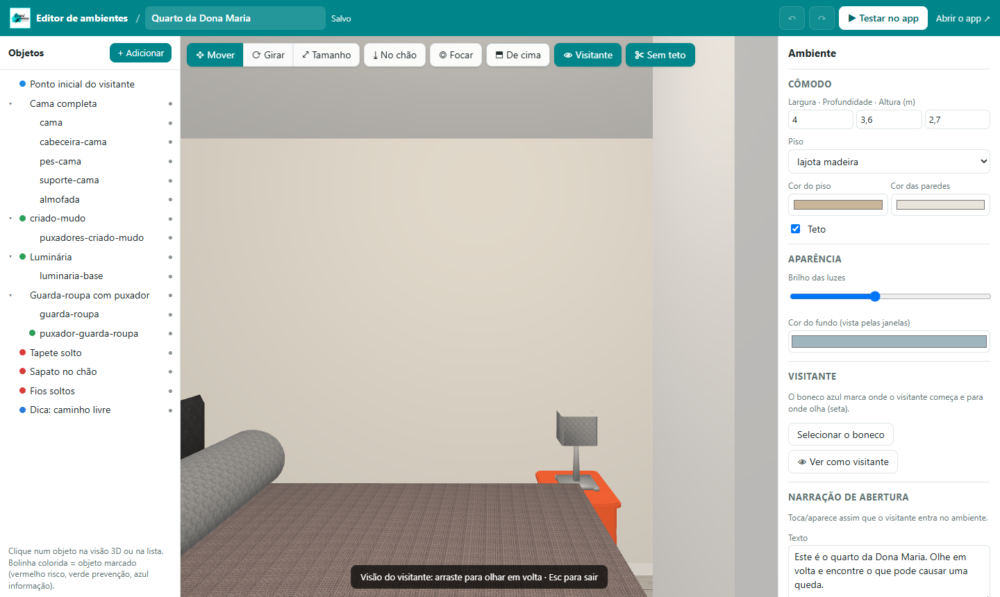

### 2.7 Configurações do ambiente e publicação

Clique num espaço vazio (ou aperte **Esc**) para ver as configurações do ambiente:

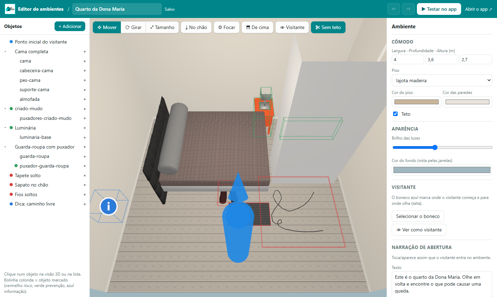

- **Cômodo**: medidas, tipo de piso, cores do piso e das paredes, teto.
- **Aparência**: brilho das luzes e a cor vista pelas janelas.
- **Narração de abertura**: texto e/ou áudio que aparecem assim que o visitante entra.
  Use para dar a tarefa, como "Encontre os 3 riscos deste quarto".

Mais embaixo fica a **Publicação**:

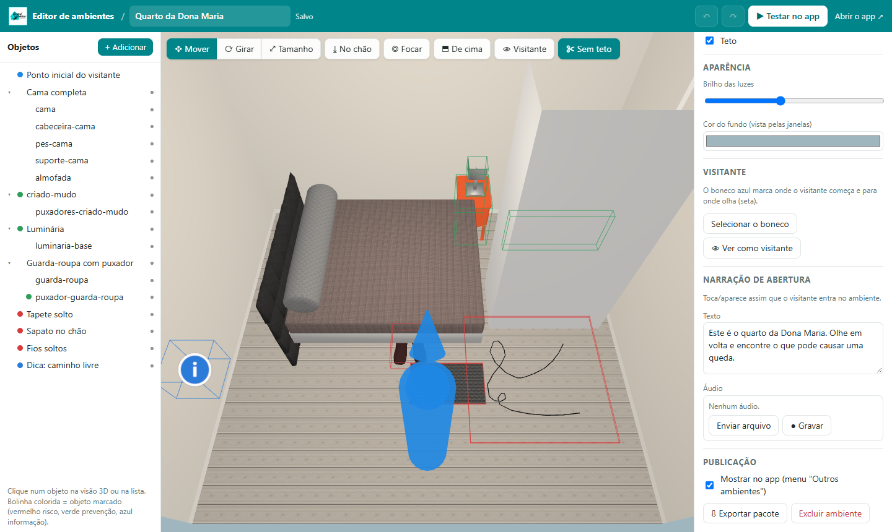

- **Mostrar no app**: marque para o ambiente aparecer no menu **Outros ambientes** do app.
  Enquanto estiver desmarcado, ele é um rascunho.
- **Exportar pacote** e **Excluir ambiente**.

Por fim, clique em **▶ Testar no app** (no topo) para experimentar como o visitante.

---

## 3. Alterando um cômodo original

Clique em **Cópia de um cômodo original** e escolha o quarto ou banheiro (adaptado ou com riscos).
Os originais **continuam iguais** no app. Você trabalha numa cópia.

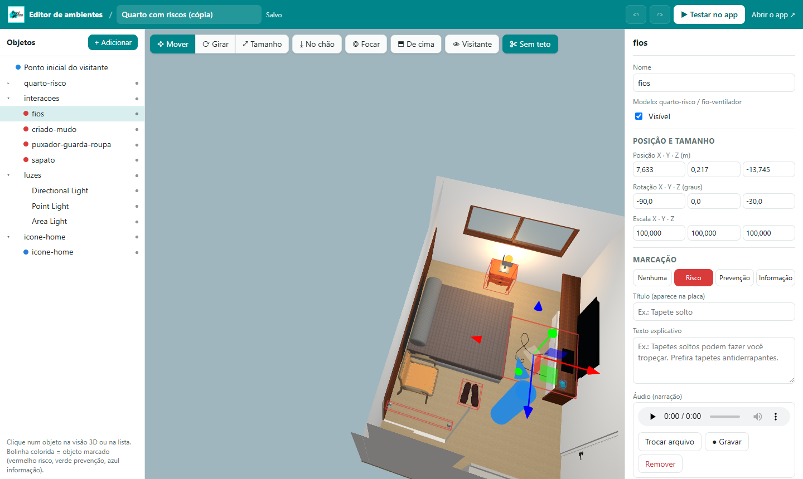

Tudo funciona como no cômodo 3D: dá para mover móveis, esconder objetos (● na lista),
adicionar riscos, trocar os textos e regravar os áudios.

---

## 4. Ambiente com foto 360°

Use quando quiser mostrar **a casa real** de alguém.

### 4.1 Como tirar a foto

- **No celular:** use o modo **Panorama 360°** ou **Photo Sphere** da câmera (no Android, apps como o
  Google Street View também fazem isso). Gire devagar, sem sair do lugar, na **altura dos olhos**.
- **Com uma câmera 360°** (Insta360, Ricoh Theta etc.): use a foto exportada em formato "equirretangular".
- A foto deve ter o formato **2:1**, com a largura o dobro da altura (ex.: 4096 × 2048).

### 4.2 Criando o ambiente

Clique em **Foto 360°**, dê um nome e escolha a foto.

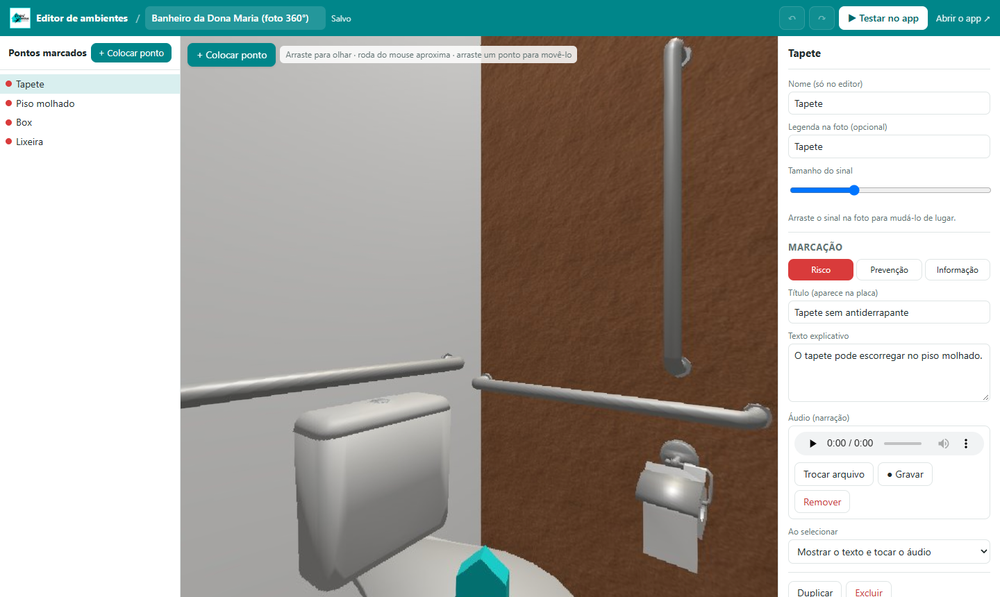

- **Olhar em volta**: arraste a imagem. A roda do mouse aproxima.
- **Marcar um ponto**: clique em **+ Colocar ponto** e depois no lugar da foto (ex.: em cima do tapete).
- **Mudar de lugar**: arraste o sinal.
- Selecione o ponto para preencher a **Marcação**, igual aos objetos 3D: tipo, título, texto, áudio
  e ação. Você também pode escrever uma **legenda**, que fica escrita embaixo do sinal na foto.
- **Direção inicial**: sem nada selecionado, gire a vista até o ponto que a pessoa deve ver primeiro
  e clique em **⌖ Usar a direção atual como inicial**.

---

## 5. Levando ambientes para outro computador

1. Na lista do editor, clique em **Exportar** no ambiente. É baixado um arquivo `.prevamb.json` com tudo
   dentro (objetos, textos, áudios e fotos).
2. No outro computador, abra o editor e clique em **Importar pacote**.

O ambiente importado chega como **rascunho**. Marque **Mostrar no app** para publicar.

---

## 6. Perguntas frequentes

**O celular não mexe a imagem quando eu viro.**
Abra pelo endereço **http://localhost:8080** com o cabo USB conectado (`npm run phone`). Por segurança,
o navegador só libera o sensor de movimento nesse endereço, ou em sites com `https`.

**Não ouço os áudios.**
Confira o volume do celular e se ele não está no silencioso. O som só é liberado depois que a pessoa toca
em "Usar com óculos" ou "Ver sem óculos" na tela de entrada.

**Fui para o menu sem querer.**
O botão **⌂ Menu** só aparece quando se olha **bem para baixo**, para os pés. Ao procurar objetos no chão,
olhe para eles, não para os próprios pés.

**O áudio que gravei não toca no iPhone.**
A gravação feita no editor usa um formato que o iPhone não reproduz. Se for usar em iPhone, envie um
arquivo **.mp3** em vez de gravar.

**Apaguei algo sem querer.**
Use **Ctrl+Z** logo em seguida. Se já saiu do ambiente, o desfazer não está mais disponível.

**Meu ambiente não aparece no app.**
Marque **Mostrar no app** nas configurações do ambiente e volte ao menu do app.
O menu lê a lista de novo toda vez que é aberto.
