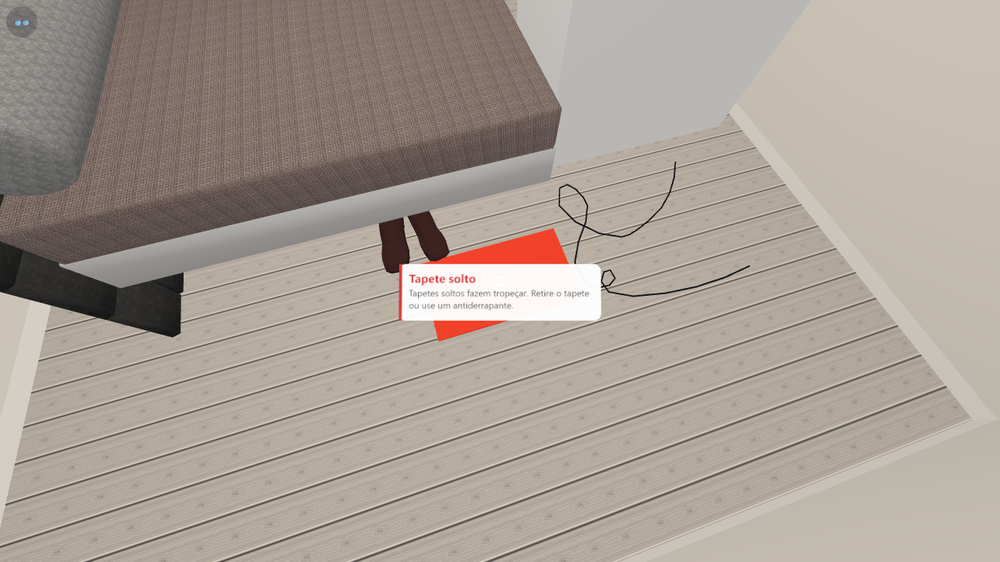

# PrevQuedasRV — versão web (A-Frame)

Realidade virtual para **prevenção de quedas em casa**, recriada do app Unity original em A-Frame (three.js).
Roda no navegador do celular (com ou sem óculos Cardboard) e vem com um **editor de ambientes** para criar
cômodos novos, marcar riscos, gravar narrações e usar fotos 360° de casas reais. Tudo funciona localmente,
sem nuvem.



## Documentação

| Documento | Para quem |
|---|---|
| **[Tutorial de uso](docs/TUTORIAL.md)** | Quem vai usar o app ou criar ambientes no editor, sem conhecimento técnico |
| **[Guia de desenvolvimento](docs/DESENVOLVIMENTO.md)** | Quem vai manter o código: arquitetura, pastas, telas, formato dos dados, salvamento, API |

## Início rápido

Pré-requisitos: Node 18+ e, opcionalmente, `ffmpeg` no PATH. O ffmpeg só é usado pelo `npm run export`.

```bash
cd web-aframe
npm install
npm run export      # 1ª vez (ou se o projeto Unity mudar): gera dados, modelos, áudios e bibliotecas
npm start           # http://localhost:8080
```

| Endereço | O que é |
|---|---|
| http://localhost:8080 | App do visitante |
| http://localhost:8080/editor.html | Editor de ambientes (PC) |

Para testar no Android com cabo USB, rode `npm run phone` e abra `http://localhost:8080` no Chrome do celular.

## Ambientes de exemplo

A pasta `public/ambientes/` vem com dois exemplos publicados, feitos no editor:

- **Quarto da Dona Maria**: cômodo 3D com riscos marcados.
- **Banheiro da Dona Maria (foto 360°)**: foto panorâmica com pontos marcados.

Eles aparecem no app em "Outros ambientes" e podem ser excluídos pelo editor.
